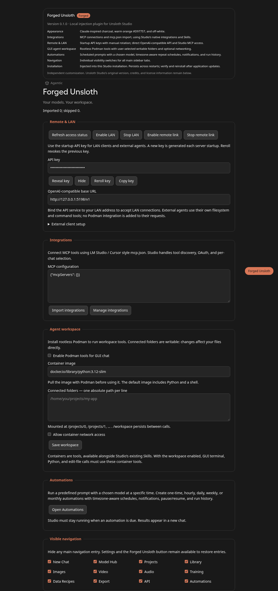

# Forged Unsloth

A plugin and installer for customizing [Unsloth Studio](https://github.com/unslothai/unsloth). This repository contains **only Forged Unsloth**: injection code, settings UI, installers, tests, and a preview. The installer downloads Unsloth separately.

## Install on Arch Linux

Run as your normal user. If Unsloth Desktop or a Studio API server is open, the installer asks permission to stop it before installation:

```bash
curl -fsSL https://raw.githubusercontent.com/oxidized-elias/forged-unsloth/main/install.sh | bash
```

The menu lets you choose full desktop, backend only, build only, download/inject only, or memory only. It shows what will be overwritten before applying your choices. You can preserve your existing AGENTS.md and skip container setup. Backend-only mode keeps the desktop package; use the injected source/API until you build a matching desktop.

The standalone Python script (`forged-unsloth-installer.py`) embeds the plugin and refined memory template, so you can also download or copy that single file and run it from another directory. **Do not launch the script with sudo.** It invokes sudo when pacman needs permission.

By default, it:

1. Fetches official Unsloth `main` and records the exact commit.
2. Injects Forged Unsloth, rejecting incompatible source layouts before replacing the installed app.
3. Installs missing Arch build dependencies and builds the desktop with the customized frontend.
4. Installs Podman dependencies, checks rootless operation, and pulls the default Debian 13 image.
5. Backs up Studio databases, authentication files, and the current desktop executable.
6. Uses Unsloth's local installer to provision the matching Python backend.
7. Installs a local `forged-unsloth` Arch package that replaces `unsloth-bin`.
8. Replaces `~/.unsloth/studio/AGENTS.md` with the refined template, unless you choose to preserve it. The previous file is backed up first.

This installs the full desktop app and its backend. Launch **Forged Unsloth** from the application menu, or run:

```bash
forged-unsloth
```

The process downloads npm, Cargo, and Python dependencies and may take substantial time and disk space. A full native build and privileged installation have not yet been verified end to end. An opt-in integration test exercises a real Debian container, package installation, a Node.js program, downloads, and cross-process interruption.

## Features

- **Appearance:** Claude-inspired charcoal `#191919`, warm orange `#D97757`, and off-white `#EFEFEF`.
- **Branding:** an orange **Forged** badge replaces the top-left Beta badge; About includes plugin version and feature information.
- **Integrations:** import LM Studio / Cursor style `mcp.json` through Studio's existing MCP system, with connection management, OAuth, and tool selection.
- **Remote & LAN:** listener controls and native API keys generated on server startup, with reveal, copy, and reroll. Reroll revokes the previous plugin key.
- **Agentic:** a composer control beside Search and Tools for a persistent Debian sandbox, arbitrary package/tool installation, and an Interrupt button. The normal Stop action and stop shortcut interrupt the workspace too.
- **Connected folders:** user-selected writable mounts let the model edit the original project files. External API clients retain their own tool environments and are not offered the Podman integration.
- **Skills:** uses Studio's existing Skills support alongside the container MCP integration.
- **Automations:** exposes Studio's scheduler for predefined prompts, chosen models, timezone-aware one-time or recurring schedules, notifications, and run history.
- **Chat titles:** model-generated names for new conversations are enabled by default, using Studio’s native title generator.
- **Browser reliability:** native load listeners register before pages open, including agent tabs. Temporary GET/proxy failures get bounded retries; submissions and blocked sites are not replayed. Startup renders even if optional initialization fails or stalls.
- **Navigation:** individual visibility switches for main sidebar entries, including New Chat and Automations.

Automations require Studio to be running when they are due. They do not wake a sleeping or powered-off computer.

<details>
<summary>Settings preview — mocked API, not a live model session</summary>



</details>

## Memory and overwrite choices

The bundled [AGENTS.md](templates/AGENTS.md) refines the user's existing instructions: concise communication, creating real downloadable artifacts, honest testing, general-purpose Debian tools, and respecting interruptions. Installation replaces the file with this template rather than merging arbitrary local edits. Each replacement saves the previous file under `~/.local/share/forged-unsloth/backups/agents-before-install-*/AGENTS.md` (or your chosen `--data-dir`), with private permissions. Symlink targets are refused. Chats, models, existing API keys, and workspace folder settings are preserved.

To bypass the menu and explicitly preserve memory:

```bash
curl -fsSL https://raw.githubusercontent.com/oxidized-elias/forged-unsloth/main/install.sh | bash -s -- --non-interactive --no-overwrite-agents
```

To replace only AGENTS.md without downloading or installing Unsloth:

```bash
curl -fsSL https://raw.githubusercontent.com/oxidized-elias/forged-unsloth/main/install.sh | bash -s -- --non-interactive --agents-only
```

The stop prompt lists detected processes belonging to your user. Approval sends SIGTERM and waits up to 15 seconds; refusal or failure to stop cancels installation. It checks again before provisioning and replacing the desktop. `--non-interactive` never stops processes automatically: close Unsloth first.

Interactive child commands, including sudo and pacman, also read `/dev/tty` when the installer is piped into Bash. All installer pacman install commands use `--noconfirm`; sudo may still ask for your password.

If an installation is interrupted after compilation, rerunning the installer automatically reuses a completed build for the same exact Unsloth commit and plugin code. It verifies injection and, for new builds, a recorded package checksum. Changed upstream commits or plugin code trigger a fresh build. An already matching backend is also reused. Incomplete compilation without a finished package is not treated as a completed build.

To finish a particular completed build without downloading or compiling again (requires its matching backend to already be provisioned):

```bash
curl -fsSL https://raw.githubusercontent.com/oxidized-elias/forged-unsloth/main/install.sh | bash -s -- --resume ~/.local/share/forged-unsloth/sources/unsloth-YOUR_SNAPSHOT
```

Resume still checks running processes, installs the package with `--noconfirm`, backs up state, applies your AGENTS.md overwrite choice, and records the completed installation. Add `--no-overwrite-agents` to preserve memory.

The menu reads `/dev/tty`, so it works when piped into Bash. For unattended use, add `--non-interactive` and your choices. The bootstrap requires Python 3 and curl; the full installer requires Arch Linux. Run it as a regular user.

## Installer options

```bash
# Print the steps without downloading or installing.
python3 forged-unsloth-installer.py --plan

# Download Unsloth and inject only.
python3 forged-unsloth-installer.py --fetch-only

# Build an Arch package without provisioning the backend or replacing the app.
python3 forged-unsloth-installer.py --build-only

# Pin the Unsloth revision used for the initial plugin implementation.
python3 forged-unsloth-installer.py --ref e4ef63188151e0229a78dcd40e6ff401e3d81d07

# Snapshot an existing checkout, including its uncommitted changes.
python3 forged-unsloth-installer.py --source /path/to/unsloth

# Install without configuring or downloading Podman components.
python3 forged-unsloth-installer.py --skip-container
```

`--ref` accepts a branch, tag, or commit. Default `main` may change; compatibility checks stop on unsupported injection points, with no automatic fallback to a different revision. The initial revision has been checked against the injection anchors; that is not a guarantee of a complete native installation.

Sources, package artifacts, provenance, and backups are retained below `${XDG_DATA_HOME:-$HOME/.local/share}/forged-unsloth`. Override this with `--data-dir`.

**Keep the active source snapshot.** The backend imports it as an editable installation. The installer upgrades the current user's backend under `~/.unsloth/studio`, where existing models and conversations remain. Backups cover SQLite state, auth files, and the executable, not every Python environment or model. Unsloth's installer retains its own rollback behavior.

Rootless Podman must be usable by your account. The installer checks it but does not edit subordinate UID/GID mappings automatically. If configuration is missing, configure rootless Podman or use `--skip-container` and enable it later.

## Podman workspace

Open **Forged Unsloth → Agent workspace**, select an image, and enter absolute project-folder paths. The default is **`docker.io/library/debian:13-slim`**, with network access enabled. It is a general Linux environment, not a Python-only execution runtime.

The AI can use `apt-get`, download installers, install language runtimes, build projects, and run applications inside the container. For example:

```bash
apt-get update
apt-get install -y curl git nodejs npm build-essential
node --version
```

`forged_terminal` runs arbitrary shell commands. `forged_python` is an optional convenience helper; Python can be installed with `apt-get install -y python3` when needed. Downloads and package installations happen in the container, without installing those applications on the host.

| Path | Purpose |
| --- | --- |
| `/workspace` | Persistent scratch files in the plugin’s configuration directory |
| `/projects/0`, `/projects/1`, … | Writable mounts of the folders you connected |
| `/root` and the container filesystem | Persistent applications, package installations, and downloaded tools |

Changes in `/projects/*` directly change the original files. Each command starts a new shell, so shell variables and `cd` do not carry over; files and installed software do. Image, network, and folder settings identify a sandbox. Changing those settings selects a different container and stops the previous one, whose filesystem is retained. Returning to the same settings reuses its container.

Root inside the container maps to an ordinary host user through rootless Podman. This allows Debian package installation without giving the AI host root. The writable container has a separate process tree and network namespace, no added privileges, and a limited capability set for package managers. CPU, memory, process-count, command-duration, and output limits remain in place. No host engine socket or host environment secrets are mounted. This is a Linux container, not a separate kernel or a guarantee that every desktop/GPU/kernel-dependent application will work.

Networking uses Podman’s supported rootless `pasta` backend from Arch’s `passt` package. The owner can select offline mode. The installer pre-pulls Debian; on first use, Podman can also pull a missing owner-selected base image. Model-driven downloads and installers run inside the sandbox.

The former default `python:3.12-slim` configuration migrates to Debian with networking enabled. Custom images and explicit offline settings saved with the Debian image are preserved.

### Interruption

Use **Interrupt** beside Agentic, **Interrupt sandbox** in settings, the normal chat **Stop** button, or the stop-generation shortcut. The chat Stop path also cancels model generation. Workspace interruption invalidates already queued commands and stops the container’s process tree, including background services and downloads. It keeps the installed packages, `/root`, connected project files, and scratch files. The next new command can restart the same container; a cancelled command is not automatically rerun.

Commands default to a five-minute timeout and can request up to one hour. A timeout stops the container’s processes and retains its filesystem. Interrupt is available through an owner-UI-only endpoint and does not wait for the workspace execution lock.

Turn on **Agentic** in the composer to enable the integration and MCP tool calling. Workspace policy is installation-wide; the chat’s MCP switch controls whether tools are offered in that chat. GUI native terminal, Python, and edit-file calls are refused while the policy is enabled and direct the model to the container tools. External clients and other accounts are not offered the integration.

### Automatic conversation names

Forged enables Studio’s native automatic title generation for new chats, and seeds the owner’s persisted setting on the first upgraded startup. The generator uses the conversation’s model and falls back to Studio’s normal title behavior if generation fails. Existing/manual titles are not overwritten. After the initial default is applied, the owner can change the native automatic-title setting without it being forced back on every restart.


## API access

External OpenAI-compatible clients use `/v1` with the generated Bearer key. OpenCode provider and Claude Code MCP examples are available in the settings panel.

To start the backend directly without `unsloth start`, use the installed Studio Python environment and the **injected source path** recorded in `installation.json`:

```bash
~/.unsloth/studio/unsloth_studio/bin/python serve.py \
  --studio /path/to/injected/unsloth/studio \
  --host 127.0.0.1 --port 8888
```

This runs a foreground API service. Use a process manager if you want it kept running. The direct launcher binds the address you supply; dynamic LAN/tunnel controls require the normal Studio launcher to configure their launch policy.

The startup key is saved at `~/.config/forged-unsloth/api-key.json` with mode `0600`. `FORGED_UNSLOTH_HOME` overrides that configuration directory. The key is not printed to logs. Restart or reroll revokes the previous plugin key, so update client configurations afterward. Other existing Studio credentials retain their native behavior.

```bash
curl http://127.0.0.1:8888/v1/models \
  -H 'Authorization: Bearer YOUR_STARTUP_KEY'
```

For Claude Code, enable Studio MCP in Settings → API or launch with `UNSLOTH_STUDIO_ENABLE_MCP=1`, then configure `.mcp.json`:

```json
{
  "mcpServers": {
    "forged-unsloth": {
      "type": "http",
      "url": "http://127.0.0.1:8888/mcp",
      "headers": { "Authorization": "Bearer YOUR_STARTUP_KEY" }
    }
  }
}
```

Studio's OpenAI-compatible API does not become an Anthropic Messages API. Claude Code accesses Studio through MCP and retains its own filesystem and command tools. Owner configuration actions continue to require the owner's regular UI session.

## Source injection and removal

To inject a matching Unsloth checkout manually:

```bash
python3 install.py install --studio /path/to/unsloth/studio
cd /path/to/unsloth/studio/frontend
npm ci --ignore-scripts
npm run build
```

The injector validates all anchors before modifying source, records installed hashes, and supports verification and removal:

```bash
python3 install.py verify --studio /path/to/unsloth/studio
python3 install.py uninstall --studio /path/to/unsloth/studio
```

Rebuild the frontend after removal. For a packaged native desktop, also rebuild its executable because its frontend is embedded. Uninstall removes the exact injected fragments and preserves unrelated source edits. It preserves plugin settings, workspace files, and API-key records; revoke unused keys in Studio's API settings.

Injection survives restarts. Application updates may replace it; rerun the installer to fetch, validate, and rebuild against a newer source revision. To return to the official Arch desktop package, install `unsloth-bin` through your AUR helper and run its backend repair/reinstallation. Reinstalling only the desktop package does not undo the editable backend.

## Development and tests

The repository contains no Unsloth source tree or history. Plugin and installer tests run independently:

```bash
python3 -m venv .venv
.venv/bin/python -m pip install -r requirements-dev.txt
.venv/bin/python -m pytest -q
```

Tests cover authorization, key rotation, external-client isolation, mount validation, install/uninstall round trips, local Git download and injection, Arch package generation, SQLite WAL backups, and the standalone installer's reproducible payload. Full native compilation, privileged installation, and live-model inference are outside the default test suite. Run the optional real-container test with rootless Podman and network access:

```bash
FORGED_PODMAN_TEST=1 .venv/bin/python -m pytest tests/test_debian_integration.py -q
```

The test installs Debian packages in its disposable container, runs Node.js, downloads a page, changes a connected file, interrupts a long-running command from another process, and verifies that tools and files survive restart. It removes only its own uniquely named container.

The browser preview requires an injected Unsloth checkout with frontend dependencies, Python Playwright, and system Chromium:

```bash
.venv/bin/python -m pip install playwright
.venv/bin/python tests/preview.py --studio /path/to/unsloth/studio
```

It uses mocked APIs and saves `artifacts/forged-unsloth.png`.

After editing the injection or plugin files, regenerate the standalone installer:

```bash
python3 build-installer.py
```

`install-arch.py` is the readable implementation embedded by `build-installer.py` into `forged-unsloth-installer.py`.

## License and references

Forged Unsloth is distributed under [AGPL-3.0-only](LICENSE). It is an independent customization; upstream Unsloth retains its own copyrights and licenses.

Reference designs: [LM Studio MCP](https://lmstudio.ai/docs/app/mcp), [Claude sandboxing](https://www.anthropic.com/research/claude-code-sandboxing), [Codex cloud environments](https://learn.chatgpt.com/docs/environments/cloud-environments). Desktop build references: [Tauri prerequisites](https://v2.tauri.app/start/prerequisites/) and [distribution](https://v2.tauri.app/distribute/).
